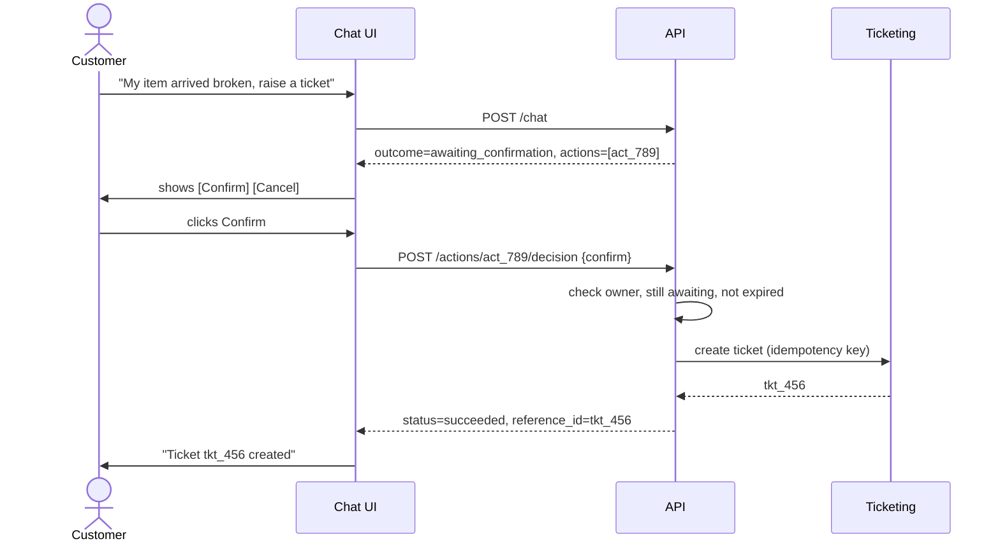

# Customer Support Agent — API Contract v1

Status: draft, the agreed contract for the API layer.
Sources: [SDD §5.1, §6](Customer_Support_Agent_SDD_v1.0.md), [BRD §6](Customer_Support_Agent_BRD_v1.0.md), [plan.md](../plan.md).

This document has three parts:

1. [Conventions](#1-conventions) that apply to every endpoint
2. [Endpoints](#2-endpoints): purpose, request, response and notes for each endpoint
3. [User workflows](#3-user-workflows): how a client uses the endpoints together

---

## 0. Endpoint summary

| # | Method and path | Purpose | Auth | Build in |
|---|---|---|---|---|
| 1 | `POST /api/v1/chat` | Send a message, get the assistant's reply | JWT | W1 stub, W2–3 real |
| 2 | `GET /api/v1/conversations` | List my conversations | JWT | W4 |
| 3 | `GET /api/v1/conversations/{id}` | Get one conversation's summary and status | JWT | W4 |
| 4 | `GET /api/v1/conversations/{id}/messages` | Get message history | JWT | W4 |
| 5 | `POST /api/v1/conversations/{id}/escalate` | "Talk to a human" button | JWT | W3 |
| 6 | `GET /api/v1/actions/{action_id}` | Check the status of a proposed or running action | JWT | W3 |
| 7 | `POST /api/v1/actions/{action_id}/decision` | Confirm or cancel a proposed action | JWT | W3 |
| 8 | `POST /api/v1/conversations/{id}/feedback` | Rate an assistant reply | JWT | W4 |
| 9 | `GET /api/v1/tickets` | List my tickets (optional) | JWT | W3 |
| 10 | `GET /api/v1/tickets/{id}` | Get one ticket's status | JWT | W3 |
| 11 | `GET /health/live` | Is the process running? | none | W1 |
| 12 | `GET /health/ready` | Can the app serve traffic? | none | W1 |

Until an endpoint is implemented, it returns `501 NOT_IMPLEMENTED` in the standard error shape.

---

## 1. Conventions

### Authentication

- `/api/v1/*` requires `Authorization: Bearer <JWT>`. `/health/*` is public.
- `customer_id` is taken **only** from the token's `sub` claim. It is never read from the request body, the URL or the model's output.
- A missing, expired or invalid token returns `401 UNAUTHENTICATED`.

### Ownership

- Requesting a resource owned by another customer returns **`404 NOT_FOUND`**, never `403`. This way the API doesn't reveal that the resource exists.

### Request correlation

- The client may send `X-Request-ID`. If it doesn't, the server generates `req_<uuid7>`.
- The ID is echoed in the `X-Request-ID` response header. Every response body, including errors, also contains it as `correlation_id`.

### Identifiers

Identifiers are opaque prefixed strings, built from UUIDv7 so they sort by creation time.

| Prefix | Resource |
|---|---|
| `conv_` | Conversation |
| `msg_` | Message |
| `act_` | Action (a proposed or executed write) |
| `tkt_` | Ticket |
| `fb_` | Feedback |
| `req_` | Request / correlation ID |

### Timestamps

ISO 8601 in UTC, for example `2026-10-23T10:15:02Z`.

### Pagination

List endpoints use cursor pagination.

- Query parameters: `?limit=20&cursor=<opaque>`, with `limit` between 1 and 100.
- Response shape: `{ "items": [...], "next_cursor": "<opaque>" | null }`. A `null` cursor means there are no more pages.

### Limits

| Limit | Value |
|---|---|
| Request body | 16 KB → `413 PAYLOAD_TOO_LARGE` |
| Chat `message` | 1–4000 characters |
| Feedback `comment` | ≤ 1000 characters |
| Escalation `note` | ≤ 500 characters |
| Rate limit | per customer → `429 RATE_LIMITED` with `Retry-After` |

Request bodies reject unknown fields.

### Idempotency (`POST /api/v1/chat` only)

The client may send `Idempotency-Key: <uuid>` so it can retry safely after a network failure. Keys are scoped per customer and kept for 24 hours.

| Situation | Result |
|---|---|
| Same key, same body | The stored response is replayed; the workflow does not run again |
| Same key, different body | `422 IDEMPOTENCY_KEY_MISMATCH` |
| Same key, first request still running | `409 REQUEST_IN_PROGRESS` (retryable) |

Other endpoints don't need a key, because they are idempotent by design. `/decision` and `/escalate` return the existing result when repeated, and feedback overwrites the earlier rating.

### Error contract

All errors share one shape:

```jsonc
{
  "error": {
    "code": "VALIDATION_ERROR",          // stable, machine-readable
    "message": "…",                      // safe to show to the customer
    "retryable": false,
    "correlation_id": "req_…",
    "details": [ { "field": "message", "issue": "too_long" } ]   // validation errors only
  }
}
```

| HTTP | Code | Retryable | When |
|---|---|---|---|
| 401 | `UNAUTHENTICATED` | no | Missing, expired or invalid token |
| 404 | `NOT_FOUND` | no | Resource doesn't exist or isn't yours |
| 409 | `CONVERSATION_CLOSED` | no | Message sent to a closed conversation |
| 409 | `REQUEST_IN_PROGRESS` | yes | Same Idempotency-Key is still running |
| 409 | `ACTION_NOT_PENDING` | no | Conflicting decision on an already-decided action |
| 409 | `ACTION_EXPIRED` | no | Decision sent after the action expired |
| 413 | `PAYLOAD_TOO_LARGE` | no | Body over 16 KB |
| 422 | `VALIDATION_ERROR` | no | Body or query failed validation (includes `details`) |
| 422 | `IDEMPOTENCY_KEY_MISMATCH` | no | Same key reused with a different body |
| 429 | `RATE_LIMITED` | yes | Too many requests (`Retry-After` header) |
| 500 | `INTERNAL_ERROR` | no | Unexpected failure; no stack trace is returned |
| 501 | `NOT_IMPLEMENTED` | no | Placeholder endpoint |
| 503 | `DEPENDENCY_UNAVAILABLE` | yes | LLM, database or other critical dependency down |
| 504 | `TIMEOUT` | yes | Request exceeded its time budget |

An **unknown write outcome is not an HTTP error**. The request itself succeeded, so it is reported as an action with `status: "unknown"` (see [Workflow E](#workflow-e-a-write-times-out)).

### Shared enums

| Enum | Values |
|---|---|
| Conversation status | `open`, `active`, `pending_human`, `resolved`, `closed` |
| Chat outcome | `answered`, `clarification_needed`, `abstained`, `escalated`, `awaiting_confirmation` |
| Action type | `create_support_ticket`, `request_refund` |
| Action status | `awaiting_confirmation`, `pending`, `succeeded`, `failed`, `rejected`, `unknown`, `declined`, `expired` |
| Ticket status | `open`, `in_progress`, `waiting_on_customer`, `resolved`, `closed` |
| Feedback rating | `up`, `down` |
| Feedback reason | `incorrect`, `unhelpful`, `missing_source`, `other` |
| Channel | `web` |

What each action status means:

| Status | Meaning |
|---|---|
| `awaiting_confirmation` | Proposed by the agent; waiting for the customer to confirm or cancel |
| `pending` | Accepted, but not finished (for example, waiting for human approval) |
| `succeeded` | Confirmed by the system of record |
| `failed` | The system of record reported failure |
| `rejected` | Blocked by policy or authorization |
| `unknown` | The outcome is uncertain (timeout after the write was sent); being reconciled |
| `declined` | The customer cancelled it |
| `expired` | The customer didn't decide in time |

---

## 2. Endpoints

### 2.1 `POST /api/v1/chat`

**Purpose:** Send a customer message and get the assistant's reply. Creates a new conversation or continues an existing one.

**Request**

```jsonc
// Headers: Authorization: Bearer <JWT>
//          Idempotency-Key: <uuid>          (optional)
{
  "conversation_id": "conv_… | null",       // null starts a new conversation
  "message": "Where is my order 1042?",
  "channel": "web"
}
```

**Response `200`**

```jsonc
{
  "conversation_id": "conv_…",
  "conversation_status": "active",
  "message": {
    "id": "msg_…",
    "role": "assistant",
    "content": "Your order 1042 shipped on Oct 20 and is in transit.",
    "created_at": "2026-10-23T10:15:02Z"
  },
  "outcome": "answered",
  "citations": [
    {
      "source_id": "doc_returns",
      "source_version": "3",
      "title": "Returns Policy",
      "section": "30-day window",
      "uri": null
    }
  ],
  "actions": [
    {
      "action_id": "act_…",
      "type": "create_support_ticket",
      "status": "awaiting_confirmation",
      "summary": "Create a ticket about a damaged item on order 1042",
      "expires_at": "2026-10-23T10:30:02Z"
    }
  ],
  "handoff": null,                          // or { "ticket_id", "status", "reason" }
  "correlation_id": "req_…"
}
```

**Errors:** `401`, `404` (unknown or foreign conversation), `409 CONVERSATION_CLOSED`, `409 REQUEST_IN_PROGRESS`, `413`, `422`, `429`, `503`, `504`.

**Notes**

- An unknown or foreign `conversation_id` returns `404`. The server **never** silently creates a new conversation in that case.
- `actions` contains only operations that **change data**. Read lookups such as order status never appear there.
- Citations leave out internal fields (`excerpt`, `retrieval_score`, `access_scope`).
- Degraded modes (SDD §11.3):
  - If the LLM is down, the call returns `503 DEPENDENCY_UNAVAILABLE`.
  - If only the CRM or ticketing system is down, it returns `200` with a reply that says live data is unavailable. Nothing is invented.
- Covers BR-001, BR-002, BR-003, BR-004, BR-005 and BR-009.

---

### 2.2 `GET /api/v1/conversations`

**Purpose:** List the caller's own conversations so they can resume one.

**Request:** `?status=active&limit=20&cursor=…` (all optional)

**Response `200`**

```jsonc
{
  "items": [
    {
      "id": "conv_…",
      "status": "active",
      "channel": "web",
      "created_at": "…",
      "updated_at": "…",
      "last_message_at": "…",
      "message_count": 6,
      "open_ticket_id": null
    }
  ],
  "next_cursor": null
}
```

**Notes:** Newest first. Not in the SDD; added for BR-002 (conversation continuity).

---

### 2.3 `GET /api/v1/conversations/{id}`

**Purpose:** Get one conversation's summary and status.

**Request:** path `id`

**Response `200`:** the same object as one item in 2.2.

**Errors:** `401`, `404`.

**Notes:** The internal `history_summary` is never returned.

---

### 2.4 `GET /api/v1/conversations/{id}/messages`

**Purpose:** Get a conversation's message history.

**Request:** `?limit=50&cursor=…`

**Response `200`**

```jsonc
{
  "items": [
    { "id": "msg_…", "role": "user", "content": "Where is my order 1042?", "created_at": "…" },
    {
      "id": "msg_…",
      "role": "assistant",
      "content": "Your order 1042 …",
      "created_at": "…",
      "outcome": "answered",
      "citations": []
    }
  ],
  "next_cursor": null
}
```

**Errors:** `401`, `404`.

**Notes**

- Oldest first.
- Only `user` and `assistant` messages are returned. Tool and system messages stay internal.
- `outcome` and `citations` appear on assistant messages only.
- Content is redacted by default (BR-016).

---

### 2.5 `POST /api/v1/conversations/{id}/escalate`

**Purpose:** The "Talk to a human" button. Creates a support ticket with the handoff context, without involving the LLM.

**Request**

```jsonc
{ "reason": "customer_requested", "note": "optional, ≤ 500 chars" }
```

**Response `201`** (new ticket) or **`200`** (an open ticket already exists)

```jsonc
{
  "handoff": {
    "status": "created",                    // created | pending
    "ticket_id": "tkt_…",                   // null while pending
    "reason": "customer_requested"
  },
  "conversation_status": "pending_human",
  "message": "A support specialist will follow up.",
  "correlation_id": "req_…"
}
```

**Errors:** `401`, `404`, `409 CONVERSATION_CLOSED`, `503`.

**Notes**

- Calling it again for the same conversation returns the same ticket, never a duplicate.
- `ticket_id` is set only after the ticketing system confirms the ticket. Until then the status is `pending`.
- The ticket carries the handoff payload built by `EscalationService`: reason, summary, relevant messages, sources, and the tools tried with their results. PII is minimized.
- Not in the SDD; added for BR-008 (escalation). It replaces the SDD's public `POST /api/v1/tickets`.

---

### 2.6 `GET /api/v1/actions/{action_id}`

**Purpose:** Check the current status of an action the agent proposed or started.

**Request:** path `action_id`

**Response `200`** (the Action object)

```jsonc
{
  "action_id": "act_…",
  "conversation_id": "conv_…",
  "type": "create_support_ticket",
  "status": "succeeded",
  "summary": "Create a ticket about a damaged item on order 1042",
  "result": { "reference_id": "tkt_…" },    // null until there is a confirmed result
  "user_message": "Your ticket tkt_… was created.",
  "expires_at": "…",
  "updated_at": "…",
  "correlation_id": "req_…"
}
```

**Errors:** `401`, `404`.

**Notes**

- Used when an outcome is `unknown` (timeout) or `pending` (waiting for human approval). The UI polls this endpoint instead of retrying the action.
- Not in the SDD; added for BR-007 (action verification).

---

### 2.7 `POST /api/v1/actions/{action_id}/decision`

**Purpose:** The Confirm and Cancel buttons. The customer approves or cancels an action the agent proposed.

**Request**

```jsonc
{ "decision": "confirm" }                   // confirm | decline
```

**Response `200`:** the Action object (same as 2.6).

**Errors:** `401`, `404`, `409 ACTION_NOT_PENDING`, `409 ACTION_EXPIRED`, `422`, `503`.

**Notes**

- The server checks ownership, that the action is still `awaiting_confirmation`, and that it hasn't expired. Only then does it run the tool. **The LLM never makes this decision.**
- Sending the same decision again returns the current state. A conflicting decision returns `409`.
- `request_refund` always ends in `pending`, because it needs human approval.
- When the action resolves, an assistant message is added to the conversation, so the history explains what happened.
- Implements SDD §9.2 step 5 ("request customer confirmation") and BR-006, BR-007 and BR-010.

---

### 2.8 `POST /api/v1/conversations/{id}/feedback`

**Purpose:** Rate a specific assistant reply with thumbs up or down.

**Request**

```jsonc
{
  "message_id": "msg_…",
  "rating": "down",
  "reason": "missing_source",               // optional
  "comment": "It didn't mention the warranty."   // optional, ≤ 1000 chars
}
```

**Response `201`** (new) or **`200`** (replaced earlier feedback)

```jsonc
{ "feedback_id": "fb_…", "created_at": "…" }
```

**Errors:** `401`, `404` (conversation or message), `422`.

**Notes**

- `message_id` must be an **assistant** message in this conversation.
- One rating per message; a resubmission overwrites the earlier one.
- Changed from the SDD by adding `message_id`, so each rating links to the exact answer, its citations and its prompt version, which makes it usable in evals.
- A feedback failure never affects chat (BR-012).

---

### 2.9 `GET /api/v1/tickets` (optional)

**Purpose:** List the caller's support tickets.

**Request:** `?status=open&limit=20&cursor=…`

**Response `200`**

```jsonc
{
  "items": [
    {
      "ticket_id": "tkt_…",
      "conversation_id": "conv_…",
      "status": "open",
      "subject": "Damaged item – order 1042",
      "created_at": "…",
      "updated_at": "…"
    }
  ],
  "next_cursor": null
}
```

**Notes:** Optional; can be skipped if Week 3 runs short.

---

### 2.10 `GET /api/v1/tickets/{id}`

**Purpose:** Show the customer the status of one ticket.

**Request:** path `id`

**Response `200`:** the same object as one item in 2.9.

**Errors:** `401`, `404`.

**Notes**

- This is the customer view only. The internal handoff payload is never exposed.
- The ticketing system (a fake adapter for now) is the source of truth for status.

---

### 2.11 `GET /health/live`

**Purpose:** Tell the platform whether the process is running.

**Response `200`**

```json
{ "status": "ok" }
```

**Notes:** No auth and no dependency checks. It must always be fast.

---

### 2.12 `GET /health/ready`

**Purpose:** Tell the platform whether the app can serve traffic.

**Response `200`** or **`503`**

```jsonc
{ "status": "ready", "checks": { "database": "ok" } }       // 200
{ "status": "not_ready", "checks": { "database": "fail" } } // 503
```

**Notes:** Never includes error messages, hostnames or other internal details. More checks, such as the embedding provider, are added as dependencies arrive.

---

## 3. User workflows

Each workflow shows what the customer does, which endpoint the client calls, and what comes back.

### Workflow A: Ask a policy question

1. The customer opens the chat and types *"How long do I have to return an item?"*
2. The client sends `POST /api/v1/chat` with `conversation_id: null`.
3. The server creates a conversation, retrieves the approved documents and generates an answer.
4. The response has `outcome: "answered"`, the answer text and `citations` pointing to *Returns Policy v3*.
5. The client stores `conversation_id` and sends it with every later message.

**Variations (BR-009):**
- If the question is ambiguous, the response has `outcome: "clarification_needed"` and the reply asks for the missing detail.
- If no approved source covers the question, it has `outcome: "abstained"`; the reply says so and offers human help.
- If the sources conflict, the response is `outcome: "abstained"` or `outcome: "escalated"`. The agent never picks one source at random.

### Workflow B: Check an order

1. The customer types *"Where is my order 1042?"*
2. The client sends `POST /api/v1/chat`.
3. The server calls `get_order_status` with the `customer_id` **from the token**, and checks that order 1042 belongs to this customer.
4. The response has `outcome: "answered"` with the live status. `actions` is empty, because this was a read.

**Variations:**
- If order 1042 belongs to another customer, the reply says the order can't be found. Nothing is revealed about it (BR-006).
- If the order system is down, the reply says live status is unavailable right now. It never guesses from old messages or documents (BR-005, BR-018).

### Workflow C: Resume a conversation

1. The customer comes back later and opens "My conversations".
2. The client calls `GET /api/v1/conversations` and shows the list.
3. The customer picks one, and the client calls `GET /api/v1/conversations/{id}/messages` to show the history.
4. The customer types a new message, and the client sends `POST /api/v1/chat` with that `conversation_id`.

### Workflow D: Create a ticket with confirmation



1. The customer types *"My item arrived broken, please raise a ticket."*
2. The client sends `POST /api/v1/chat`. The response has `outcome: "awaiting_confirmation"` and one action, `act_789`, with a `summary`.
3. The UI shows the summary with **Confirm** and **Cancel** buttons.
4. The customer clicks Confirm, and the client sends `POST /api/v1/actions/act_789/decision` with `{ "decision": "confirm" }`.
5. The server checks the action, creates the ticket and returns `status: "succeeded"` with `reference_id: "tkt_456"`.

**Variations:**
- If the customer clicks Cancel, the action ends as `status: "declined"` and nothing is created.
- If the customer waits too long, the action ends as `status: "expired"`, and a decision returns `409 ACTION_EXPIRED`.
- If the customer double-clicks Confirm, the second call returns the same result. No second ticket is created.

### Workflow E: A write times out

1. In Workflow D step 5, the ticketing system times out after the request was sent.
2. The decision response has `status: "unknown"` and `user_message: "We're checking whether your ticket was created."`
3. The server does **not** retry blindly, because that could create a duplicate. It reconciles the outcome with the ticketing system.
4. The UI polls `GET /api/v1/actions/act_789` every few seconds.
5. Once reconciled, the status becomes `succeeded` (with `reference_id`) or `failed`. The UI updates.

The agent never says "done" until the system of record confirms it (BR-007).

### Workflow F: Request a refund

1. The customer types *"I want a refund for order 1042."*
2. The response has `outcome: "awaiting_confirmation"` and a `request_refund` action.
3. The customer confirms through `POST /api/v1/actions/{id}/decision`.
4. The server **does not issue a refund**. It creates a ticket for human approval and returns `status: "pending"`, with `user_message: "Your refund request was sent for review."`
5. The customer can follow it with `GET /api/v1/actions/{id}` or `GET /api/v1/tickets/{id}`.

### Workflow G: Talk to a human

1. At any point, the customer clicks **"Talk to a human"**.
2. The client sends `POST /api/v1/conversations/{id}/escalate` with `{ "reason": "customer_requested" }`.
3. The server creates a ticket with the handoff context. It returns `201` with `ticket_id`, and the conversation becomes `pending_human`.
4. If the customer clicks again, the server returns `200` with the same ticket.

The agent can also escalate by itself, for example for sensitive requests or repeated failures. In that case the chat response has `outcome: "escalated"` and a filled-in `handoff` object.

### Workflow H: Rate an answer

1. The customer clicks 👎 on an assistant reply.
2. The client sends `POST /api/v1/conversations/{id}/feedback` with `message_id`, `rating: "down"` and an optional reason or comment.
3. The response is `201`. If the customer changes their mind and clicks 👍, the same call returns `200` and replaces the rating.

### Workflow I: Check a ticket

1. The customer opens "My tickets".
2. The client calls `GET /api/v1/tickets`, or `GET /api/v1/tickets/{id}` for one ticket.
3. The UI shows the status (`open`, `in_progress`, `waiting_on_customer`, `resolved` or `closed`).

### Workflow J: Network failure and retry

1. The client sends `POST /api/v1/chat` with `Idempotency-Key: k1`. The connection drops before the response arrives.
2. The client resends the same body with the same `k1`.
3. If the first request finished, the server replays the stored response and the workflow doesn't run twice.
4. If the first request is still running, the server returns `409 REQUEST_IN_PROGRESS`, and the client retries shortly.

---

## 4. Changes from the SDD

| Change | Reason |
|---|---|
| Removed public `POST /api/v1/tickets` | A second path to tickets would skip duplicate protection and the handoff payload. Tickets are created only through chat actions (2.7) or `/escalate` (2.5). |
| Added `GET /api/v1/conversations` | Lets customers find and resume conversations (BR-002). |
| Added `POST /api/v1/conversations/{id}/escalate` | A guaranteed path to a human that doesn't depend on the LLM (BR-008). |
| Added `GET /api/v1/actions/{id}` and `POST /api/v1/actions/{id}/decision` | Customer confirmation outside the LLM (SDD §9.2), and a way to follow uncertain outcomes (BR-007). |
| Added `GET /api/v1/tickets` | Ticket list for the customer (optional). |
| Feedback takes `message_id` | Ties ratings to a specific answer, so they can be used in evals. |
| Error contract adds `details` | Field-level validation messages. |

## 5. Persistence this contract needs

The Day 3 migration in [plan.md](../plan.md) also needs these tables:

| Table | Used by |
|---|---|
| `idempotency_record` | `POST /chat` with `Idempotency-Key` |
| `pending_action` (or `tool_execution` with status `awaiting_confirmation`) | 2.6 and 2.7 |
| `ticket` | 2.5, 2.9 and 2.10 |
| `feedback` | 2.8 |

## 6. Out of scope for v1

- Streaming responses (SSE) for `/chat`. The `message` object is shaped so it can be streamed later.
- Closing or reopening conversations through the API.
- Internal or admin APIs for documents, ingestion and eval runs. CLIs cover these for now.
- A support-agent view of tickets and handoff payloads.
